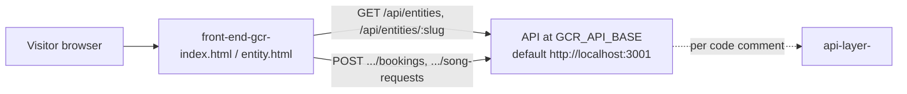

# front-end-gcr-

A small no-build website that lists local businesses and shows one business's page, reading everything from a separate API.

## What it is

The public face of "Gulf Coast Radar": a searchable directory of businesses and topics, plus a detail
page per business with hours, photos, content sections and pop-up tools such as "Book Now" and song requests.
It stores no data itself; every page asks an API server.

## How it works

- `index.html` + `js/entities-list.js`: search box, a business/topic type filter, and a paginated grid of entities.
- `entity.html` + `js/entity-detail.js`: reads `?slug=` from the URL and renders tags, hours, photos, content
  sections and tool buttons.
- `js/api.js`: the only network code. `API_BASE` is `window.GCR_API_BASE`, defaulting to `http://localhost:3001`
  (also set inline in both HTML files). It calls `GET /api/entities`, `GET /api/entities/:slug`,
  `POST /api/entities/:slug/bookings` and `POST /api/entities/:slug/song-requests`.
- `js/tools.js`: modal popups with a booking form (name, email, phone, party size, date, time, notes) and a song-request form.
- `css/styles.css`: styling. No `package.json`, no build step, no server-side env vars.
- A comment in `index.html` says the default target is the local `api-layer-` server.

## Run it

Serve the folder with any static server and start a compatible API on port 3001:

```bash
python3 -m http.server 8080      # then open http://localhost:8080/index.html
```

To use another API, set `window.GCR_API_BASE` in the browser console or in the inline script tag.
No environment variables. Not executed while writing this README. Without an API running the list shows
"Couldn't reach the API", and the API must allow cross-origin requests.

## Status

Stalled: a clean, small, read-only directory front end (last commit July 2026) that depends on an API not in this repo.

## Where it fits



## Related repos

- `api-layer-`: the API this front end points at, per the comment in `index.html`.
- `gcr-api-clean`: exposes the same entity / slug / tools model under `/api/entities`.
- `gulf-coast-radar`: an older monolith with its own dashboards and CSVs; not a copy of this.
